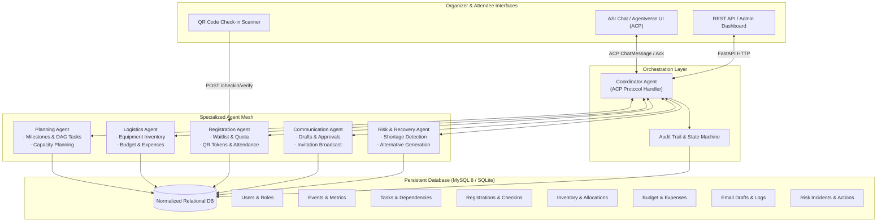
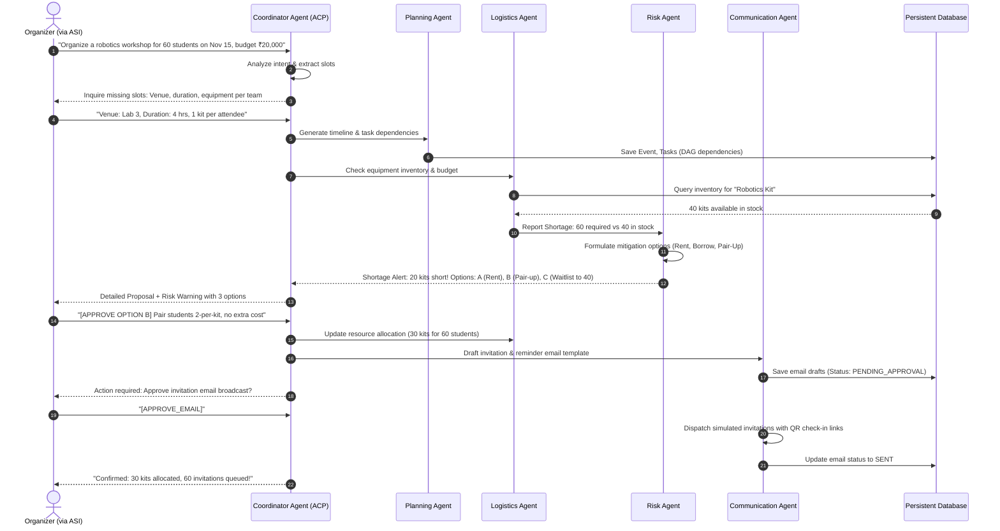

# EventPilot AI — Architecture & Data-Flow Specification

## 1. System Overview
**EventPilot AI** is an autonomous multi-agent event orchestration system designed for college clubs, robotics teams, student societies, and workshop organizers. It bridges the gap between natural language intent and reliable physical/digital event execution.

Built upon the **Fetch.ai uAgents Framework** and the **Agent Chat Protocol (ACP v0.3.0)**, EventPilot AI interfaces seamlessly with **ASI:One / Agentverse**, translating complex organizer requests into validated database transactions, dependency-ordered schedules, resource allocations, automated risk mitigation, and attendee check-in workflows.

---

## 2. Architecture Diagram

---

## 3. Data Flow Diagram: From Intent to Action

The following sequence outlines the standard end-to-end lifecycle for an event organizer, demonstrating the strict approval gates and deterministic state changes:

---

## 4. Multi-Agent Design & Separation of Concerns

1. **Coordinator Agent**:
   - Manages ACP sessions (`ChatMessage`, `ChatAcknowledgement`, `TextContent`).
   - Acts as the primary router and intent parser.
   - Enforces approval gates before executing any mutating tool.
2. **Planning Agent**:
   - Computes task dependencies using a Directed Acyclic Graph (DAG).
   - Generates milestone-driven event schedules.
3. **Logistics Agent**:
   - Manages venue readiness, equipment reserves, and expense ledgers.
   - Calculates remaining budget and validates expense transactions.
4. **Registration Agent**:
   - Manages capacity quotas, prevents duplicate registrations (atomic DB checks).
   - Handles waitlist queues and auto-promotion upon cancellations.
   - Generates cryptographically signed QR tokens for check-ins.
5. **Communication Agent**:
   - Drafts announcements, registration confirmations, and reminders.
   - Enforces human-in-the-loop approvals before external delivery.
6. **Risk & Recovery Agent**:
   - Continuously audits deadlines, overdue tasks, and inventory deficits.
   - Formulates grounded mitigation options with cost/impact projections.

---

## 5. Security & Reliability Architecture
- **Idempotency Keys**: All financial transactions, status transitions, and check-ins check deduplication hashes.
- **Signed QR Tokens**: HMAC-SHA256 signature verification prevents token forgery and double check-ins.
- **Strict Approval Gates**: No emails are sent, no funds committed, and no session formats altered without explicit user confirmation (`[APPROVE]` token).
- **Dual Database Support**: Fully tested on MySQL 8 with an automatic SQLite fallback for lightweight development and testing.
